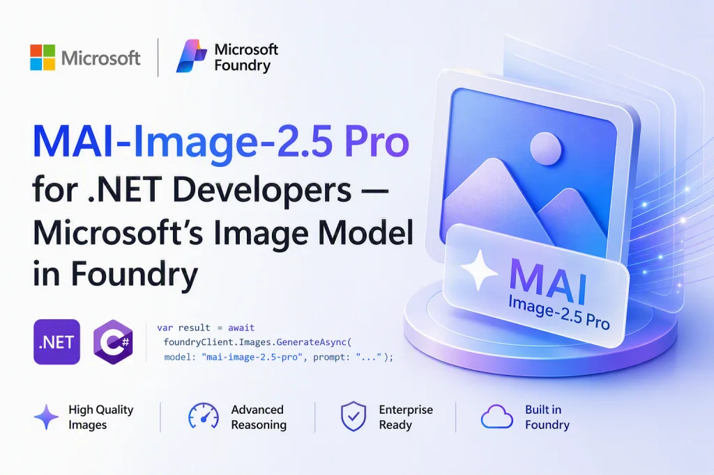
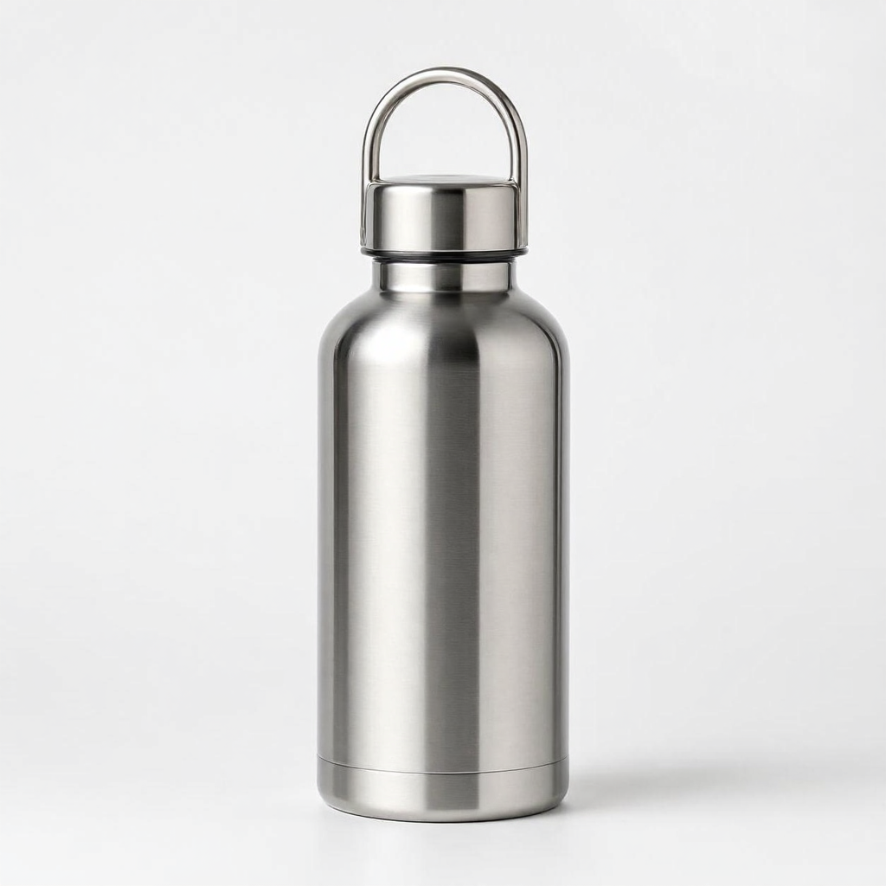

# MAI-Image-2.5-Pro C# Sample

[](https://github.com/taswar/MAI-Image-2.5-Pro-Sample/actions/workflows/dotnet.yml)

[](LICENSE)
[](CONTRIBUTING.md)

- 📖 Full walkthrough: [MAI-Image-2.5 Pro for .NET Developers — Microsoft’s Own Image Model Lands in Foundry](https://taswar.zeytinsoft.com/mai-image-2-5-pro-dotnet-developers/)
- ⭐ If this sample helps you, star the repo so other .NET developers can find it.
- 🔁 Related: [MAI Image 2.6 C# Demo](https://github.com/taswar/MAI-Image-26-Foundry-Demo) and [GPT Image 2.5 Flare and Sunburst Demo](https://github.com/taswar/GptImage2.5-flare-sunburst-demo)
- For more C# samples using other AI models, see [AI models for C# developers](https://taswar.zeytinsoft.com/foundry-ai-models-csharp/)
- For my free ebook on prompt engineering, see [Prompt Engineering for .NET Developers](https://github.com/taswar/PromptEngineeringForDotNetDevelopers)

A minimal .NET 10 console app that generates and edits images using the **MAI-Image-2.5-Pro** model hosted on **Microsoft Foundry**, with Entra ID (passwordless) authentication.

| Generated | Edited: "change the bottle to matte black" |
| --- | --- |
|  |  |

Unlike the standard Azure OpenAI image models, MAI-Image models are exposed through a custom REST route (`/mai/v1/images/generations` and `/mai/v1/images/edits`) rather than the standard `openai/deployments/{model}/images/...` path used by the `Azure.AI.OpenAI` SDK's `ImageClient`. Because of this, the app calls the REST API directly with `HttpClient` instead of using the SDK's image client.

## Prerequisites

- [.NET 10 SDK](https://dotnet.microsoft.com/download)
- [Azure CLI](https://learn.microsoft.com/cli/azure/install-azure-cli)
- A Microsoft Foundry resource with **MAI-Image-2.5-Pro** deployed
- The **Cognitive Services User** (or **Azure AI Developer**) role assigned to your identity on the Foundry resource

## Required libraries

The app depends on the following NuGet packages (already referenced in `MAI-Image-2.5-Pro-Sample.csproj`):

| Package | Version |
| --- | --- |
| `Azure.AI.OpenAI` | `2.9.0-beta.1` |
| `Azure.Identity` | `1.21.0` |

To restore the packages for this project:

```powershell
dotnet restore
```

## Configuration

The app reads two environment variables:

| Variable | Required | Description |
| --- | --- | --- |
| `AZURE_AI_FOUNDRY_ENDPOINT` | Yes | The base Foundry resource endpoint, e.g. `https://<your-resource>.services.ai.azure.com/` |
| `AZURE_AI_IMAGE_MODEL` | No | Model deployment name. Defaults to `MAI-Image-2.5-Pro`. |

## Quick start

```powershell
git clone https://github.com/taswar/MAI-Image-2.5-Pro-Sample.git
cd MAI-Image-2.5-Pro-Sample
az login
$env:AZURE_AI_FOUNDRY_ENDPOINT = "https://<your-resource>.services.ai.azure.com/"
dotnet run
```

## How to run

1. Sign in with the Azure CLI (used by `DefaultAzureCredential`):

   ```powershell
   az login
   ```

2. Set the endpoint (and optionally the model) for the current terminal session:

   ```powershell
   $env:AZURE_AI_FOUNDRY_ENDPOINT = "https://<your-resource>.services.ai.azure.com/"
   $env:AZURE_AI_IMAGE_MODEL = "MAI-Image-2.5-Pro"
   ```

3. Run the app:

   ```powershell
   dotnet run
   ```

The app will:

1. Generate a product photo of a stainless steel water bottle and save it to `product-bottle.png`.
2. Edit that image (changing the bottle color to matte black) via `POST /mai/v1/images/edits` and save the result to `product-bottle-black.png`.

## API details

| Operation | Route | Content type |
| --- | --- | --- |
| Generate | `{endpoint}/mai/v1/images/generations?api-version=preview` | `application/json` |
| Edit | `{endpoint}/mai/v1/images/edits?api-version=preview` | `multipart/form-data` (`prompt`, `model`, `image`) |

Both responses return a JSON body of the form `{ "data": [ { "b64_json": "..." } ] }`, which the app decodes and writes to disk as PNG.

## Authentication notes

- Authentication uses `DefaultAzureCredential`, which tries Azure CLI, Visual Studio, managed identity, and other credential sources in order.
- The bearer token is requested for the `https://cognitiveservices.azure.com/.default` scope.

## Troubleshooting

| Error | Cause | Fix |
| --- | --- | --- |
| `Set AZURE_AI_FOUNDRY_ENDPOINT.` | Endpoint not set | Set `AZURE_AI_FOUNDRY_ENDPOINT` in the current terminal |
| `500 InternalServerError: "Unable to get resource information."` | The model in `AZURE_AI_IMAGE_MODEL` isn't actually deployed on this resource | Check the **Deployments** tab (not the model catalog) in Microsoft Foundry and use the exact deployment name |
| `HTTP 404 not_found` (when using `Azure.AI.OpenAI`'s `ImageClient`) | The SDK posts to `openai/deployments/{model}/images/generations`, which doesn't exist for MAI-Image models | Use the raw `HttpClient` call to `/mai/v1/images/...` shown in this sample instead of the SDK's `ImageClient` |
| `401 Unauthorized` | Wrong subscription/tenant signed in, or missing role assignment | Run `az login` with the correct account and confirm the **Cognitive Services User** role on the resource |

## Project layout

```
Program.cs                        Generate and edit calls with HttpClient
MAI-Image-2.5-Pro-Sample.csproj   .NET 10 project and package references
product-bottle.png                Example output of the generate step
product-bottle-black.png          Example output of the edit step
CONTRIBUTING.md                   How to contribute
.github/workflows/dotnet.yml      Build workflow
LICENSE                           MIT license
```

## License

This project is licensed under the MIT License. See [LICENSE](LICENSE).
